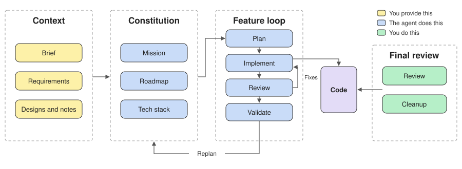

# spec-driven

This repo holds a small spec-driven workflow for Claude Code. It is made for projects where you write some of the code yourself and the agent writes the rest. Take-home projects, interview prep, and learning a new codebase are good fits.

The workflow is two skill files and no install step. Each skill is one short Markdown file.

## What it does



The context goes into the constitution. Each feature then runs through the loop and adds to the code. After each merge, the replan step updates the constitution before the next feature starts. You do the review step and the final review yourself.

You run one mode at a time with `/spec-driven <mode>`. The modes run in this order.

1. The `constitution` mode reads your project brief and writes a mission, a tech stack, and a numbered roadmap into `specs/`. It also writes a short `CLAUDE.md`.
2. The `plan` mode makes a feature branch and writes the requirements, the plan, and the validation checks for one feature.
3. The `implement` mode writes the code and the tests that the plan gives to the agent. It skips the steps that you own.
4. The `validate` mode runs every check and records a pass or a fail.
5. The `replan` mode runs after you merge. It marks the feature done, updates the changelog, and fixes any spec file that no longer matches the code.

If you run `/spec-driven` with no mode, the skill looks at `specs/` and the git state and tells you which mode comes next.

## How it differs from larger frameworks

GitHub Spec Kit and similar tools cover more ground. This workflow is smaller and adds a few rules that those tools do not focus on.

- You tell `CLAUDE.md` which code you write by hand, and the agent never writes that code.
- Each mode runs in its own session, so every step starts with fresh context.
- Every requirement in the brief must map to a roadmap feature, and every feature requirement must have a passing check.
- Every worked example in the brief becomes a test case.
- The agent never commits or merges. You do.

## Install

Copy the `.claude/skills/` folder into the root of your project. Claude Code finds the skills there for anyone who opens the project.

To use the skills in all your projects, copy the two folders into `~/.claude/skills/` instead.

The `replan` mode calls the `changelog` skill. Keep both skills together. If the changelog skill is missing, `replan` skips that step and tells you.

## Settings in CLAUDE.md

The `constitution` mode asks you three questions and records the answers in `CLAUDE.md`. You can also edit them by hand.

- You list the code that you write by hand.
- You list the folders that you own, such as `docs/`. The agent does not write in them.
- You state how commits must be marked. Some teams and schools require you to disclose AI help, and others do not. The agent follows what you write here.

## Files the workflow creates

```text
CLAUDE.md
CHANGELOG.md
specs/
  mission.md
  tech-stack.md
  roadmap.md
  features/
    01-example/
      requirements.md
      plan.md
      validation.md
```

## License

This project uses the MIT License. See `LICENSE`.
